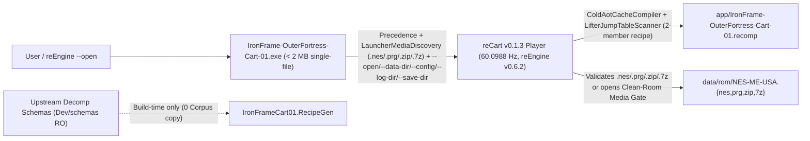
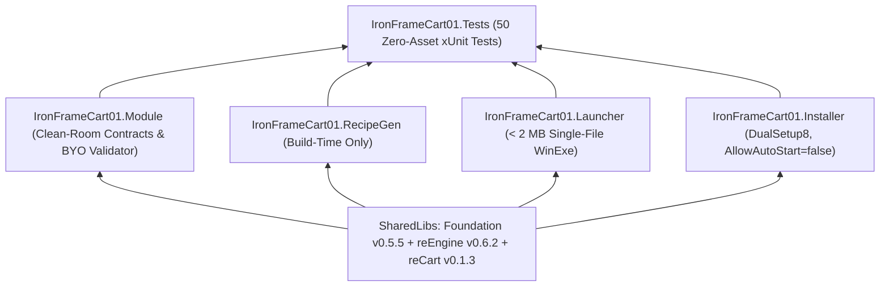

# IronFrame OuterFortress (Cart) 01 — Architecture & Engineering (`v0.1.0`)

Architecture specification for **`IronFrame-OuterFortress-Cart-01`** (`v0.1.0`, module ID `ironframe-outerfortress-cart-01`, repository `IronFrame-OuterFortress-Cart-01-Recomp`) — the downstream 4-folder clean-room static recompilation module for **IronFrame OuterFortress (Cart) 01** hosted on `reCart v0.1.3`, `reEngine v0.6.2`, and `Foundation v0.5.5`.

## 1. System Context & Runtime Model

1. **Zero Distributed Retail Code or Assets:** This repository and its releases distribute no copyrighted cartridge bytes, no disassembled C bodies, and no precompiled `*.Generated.dll` game binaries.
2. **2-Member Clean-Room `.recomp` Archive (`9,167 B`):** `app\IronFrame-OuterFortress-Cart-01.recomp` contains strictly two UTF-8 JSON entries: `module.recomp.json` and `aot-recipe.json` (`499` schema-derived seeds across fixed `PRG_FIXED_07` and switchable `BANK_00..06`, `37` entry vectors/anchors, `jumpTables: ["0xC6B7"]` with `0` hardcoded retail ROM addresses, `17` UNROM `$C932..$C958` / `$FFD0..$FFD7` trampolines, and `$0200`/`$0300`/`$0380` WRAM watches).
3. **Instant-Window Async Local Ahead-of-Time Cache Compilation:** At runtime, `reCart`'s `ColdAotCacheCompiler` and `LifterJumpTableScanner` validate the user's BYO `.nes` (`131,088` B), headerless `.prg` (`131,072` B synthesized in memory via `CartPrgHeaderSynthesizer`), `.zip`, or `.7z` archive (`CartMediaArchiveLoader` + `Foundation.Retro.MediaContainerExtractor` + bundled `app\tools\{7z.exe,7z.dll,LICENSE-7ZIP.txt}`), open the SDL3 window immediately with live `"Preparing Native Module..."` overlay feedback (`HostAotCompileOverlayView`), and compile `<dataDir>\cache\*.Generated.dll` asynchronously on the player's machine (lifting `$C2BD -> JSR $C6B7 -> $C2C6/$C2F5` cleanly across fixed and switchable banks directly from the BYO ROM).

## 2. Assembly / Project Dependency Graph

| Project | Output Type | Packaging Target |
| :--- | :--- | :--- |
| `IronFrameCart01.RecipeGen` | Build-Time Console Tool | Dev/build-time only (omitted from `Builds\` and `.recomp`) |
| `IronFrameCart01.Module` | Class Library (`net8.0`) | Clean-room module metadata, BYO `.nes`/`.prg` validation, SoA telemetry helpers |
| `IronFrameCart01.Launcher` | Single-File `WinExe` (`< 2 MB`) | Clean Build/Install Root (`IronFrame-OuterFortress-Cart-01.exe`, embeds `Foundation.{Core,Launcher,Retro}`, `reEngine.Core`, `reCart.Contracts`, `settings.example.json`) |
| `IronFrameCart01.Installer` | Dual-Setup `WinExe` (`AllowAutoStart = false`) | Signed Online + Offline Setup (`DualSetup8` 8-file `Releases\`) |
| `IronFrameCart01.Tests` | xUnit Test Assembly (`net8.0-windows`) | Isolated CI/local verification suite (`APP_ISOLATED_TEST=1`) |

## 3. End-to-End Clean-Room Data Flow

1. **Build-Time Recipe Emission (`RecipeGen`):** [`OracleSchemaLoader`](../src/IronFrameCart01.RecipeGen/OracleSchemaLoader.cs#L31-L282) reads read-only upstream `functions_catalog.json`, `anchor_functions.json`, and `d3_module_map.json`, stripping non-clean-room tokens, and [`AotRecipeEmitter`](../src/IronFrameCart01.RecipeGen/AotRecipeEmitter.cs#L13-L184) emits deterministic `Dev\src\IronFrameCart01.Module\Manifests\aot-recipe.json`.
2. **2-Member Packaging (`pack_recomp_module.ps1`):** Combines `Dev\module.recomp.json` (with `"defaultFramerateMode": "lockedCap"`) and `aot-recipe.json` into `Builds\v0.1.0\app\IronFrame-OuterFortress-Cart-01.recomp`, enforcing zero `.dll`/`.g.cs`/`.nes` entries and Zip-Slip path containment.
3. **Launcher, Pre-Flight `.7z` Media Discovery & Runtime Containment (`Launcher`):** [`LauncherCliAndContainment`](../src/IronFrameCart01.Launcher/LauncherCliAndContainment.cs#L41-L404) strips any `--autostart` flags, rebases relative paths to the caller CWD, seeds split-domain `settings*.json` files via `SettingsDomainStore`, enforces `APP_ISOLATED_TEST=1` and `FOUNDATION_SANDBOX_ROOT` containment, resolves `reCart` via [`EngineResolver`](../src/IronFrameCart01.Launcher/EngineResolver.cs#L19-L293) (deterministic discovery precedence), and runs pre-flight BYO discovery across `.nes`/`.prg`/`.zip`/`.7z` via [`LauncherMediaDiscovery`](../src/IronFrameCart01.Launcher/LauncherMediaDiscovery.cs#L1-L291) (`ResolveSevenZipOverridePath` locating `tools\7z.exe` + `MediaContainerExtractor` with ephemeral `finally` cleanup, forwarding `--rom <path>` on match or `--preload-media` to open the Clean-Room Media Gate when absent). On launch, `reEngine.Host v0.6.2` hydrates and dirty-persists `F1` Video/Audio settings via `HostSettingsStore`, eliminates `F3` HUD width jitter (`0 px`), and defers synthetic non-hotkey tap release by 2 frames; standalone raw-ROM launches without `.recomp` route cleanly to `reCart`'s Clean-Room Media Gate instead of crashing.

## 4. File & Symbol Lookup Registry

| Domain | Source File | Key Symbols & Live Anchors |
| :--- | :--- | :--- |
| Oracle Loader | [OracleSchemaLoader.cs](../src/IronFrameCart01.RecipeGen/OracleSchemaLoader.cs) | [`Load`](../src/IronFrameCart01.RecipeGen/OracleSchemaLoader.cs#L79-L124), [`ParseProgramBank`](../src/IronFrameCart01.RecipeGen/OracleSchemaLoader.cs#L127-L138), [`AssertCleanRoomText`](../src/IronFrameCart01.RecipeGen/OracleSchemaLoader.cs#L159-L171) |
| Recipe Emitter | [AotRecipeEmitter.cs](../src/IronFrameCart01.RecipeGen/AotRecipeEmitter.cs) | [`Emit`](../src/IronFrameCart01.RecipeGen/AotRecipeEmitter.cs#L41-L68), [`BuildSeeds`](../src/IronFrameCart01.RecipeGen/AotRecipeEmitter.cs#L70-L82), [`BuildTrampolines`](../src/IronFrameCart01.RecipeGen/AotRecipeEmitter.cs#L123-L149) |
| RecipeGen CLI | [RecipeGen/Program.cs](../src/IronFrameCart01.RecipeGen/Program.cs) | [`Main`](../src/IronFrameCart01.RecipeGen/Program.cs#L16), [`Run`](../src/IronFrameCart01.RecipeGen/Program.cs#L19-L87) |
| Cart Constants | [Cart01Constants.cs](../src/IronFrameCart01.Module/Cart01Constants.cs) | [`CreateDefaultManifest`](../src/IronFrameCart01.Module/Cart01Constants.cs#L146-L173), [`IsTrampolineAddress`](../src/IronFrameCart01.Module/Cart01Constants.cs#L140) |
| BYO Validation | [ByoRomValidator.cs](../src/IronFrameCart01.Module/ByoRomValidator.cs) | [`ValidateDirectory`](../src/IronFrameCart01.Module/ByoRomValidator.cs#L80-L98), [`ValidateFile`](../src/IronFrameCart01.Module/ByoRomValidator.cs#L101-L129), [`ValidateBytes`](../src/IronFrameCart01.Module/ByoRomValidator.cs#L132-L153) |
| SoA Watch | [Cart01MemoryWatch.cs](../src/IronFrameCart01.Module/Cart01MemoryWatch.cs) | [`CaptureSnapshot`](../src/IronFrameCart01.Module/Cart01MemoryWatch.cs#L261-L270), [`ReadOamShadow`](../src/IronFrameCart01.Module/Cart01MemoryWatch.cs#L273-L277), [`ReadAudioTelemetry`](../src/IronFrameCart01.Module/Cart01MemoryWatch.cs#L287-L291) |
| `.recomp` Loader | [Cart01RecipeLoader.cs](../src/IronFrameCart01.Module/Cart01RecipeLoader.cs) | [`LoadFromFiles`](../src/IronFrameCart01.Module/Cart01RecipeLoader.cs#L72-L90), [`LoadFromArchive`](../src/IronFrameCart01.Module/Cart01RecipeLoader.cs#L120-L146), [`PackageCleanRoomArchiveFromFiles`](../src/IronFrameCart01.Module/Cart01RecipeLoader.cs#L213-L220) |
| Launcher Host | [Launcher/Program.cs](../src/IronFrameCart01.Launcher/Program.cs) | [`Main`](../src/IronFrameCart01.Launcher/Program.cs#L42-L46), [`Run`](../src/IronFrameCart01.Launcher/Program.cs#L53-L121), [`BuildPlayerArguments`](../src/IronFrameCart01.Launcher/Program.cs#L130-L144) |
| Media Discovery | [LauncherMediaDiscovery.cs](../src/IronFrameCart01.Launcher/LauncherMediaDiscovery.cs#L1-L291) | [`ApplyPreFlightRomDiscovery`](../src/IronFrameCart01.Launcher/LauncherMediaDiscovery.cs#L22-L50), [`DiscoverVerifiedRomPath`](../src/IronFrameCart01.Launcher/LauncherMediaDiscovery.cs#L52-L97), [`ResolveSevenZipOverridePath`](../src/IronFrameCart01.Launcher/LauncherMediaDiscovery.cs#L133-L156), [`ComputeSevenZipRomSha256Hex`](../src/IronFrameCart01.Launcher/LauncherMediaDiscovery.cs#L185-L234), [`ResolveSafeSuiteRoot`](../src/IronFrameCart01.Launcher/LauncherMediaDiscovery.cs#L275-L290) |
| Launcher CLI | [LauncherCliAndContainment.cs](../src/IronFrameCart01.Launcher/LauncherCliAndContainment.cs) | [`ParseAndNormalize`](../src/IronFrameCart01.Launcher/LauncherCliAndContainment.cs#L175-L225), [`ValidateContainment`](../src/IronFrameCart01.Launcher/LauncherCliAndContainment.cs#L235-L269), [`SeedDefaultSettingsIfMissing`](../src/IronFrameCart01.Launcher/LauncherCliAndContainment.cs#L292-L321) |
| Engine Resolver | [EngineResolver.cs](../src/IronFrameCart01.Launcher/EngineResolver.cs) | [`ResolvePlayerExecutable`](../src/IronFrameCart01.Launcher/EngineResolver.cs#L31-L60) |
| Installer Host | [Installer/Program.cs](../src/IronFrameCart01.Installer/Program.cs) | [`RunMain`](../src/IronFrameCart01.Installer/Program.cs#L30-L89), [`TryResolveAdjacentVerifiedPortableZip`](../src/IronFrameCart01.Installer/Program.cs#L138-L164), [`RunCliFlow`](../src/IronFrameCart01.Installer/Program.cs#L175-L265) |
| Installer Wizard | [InstallerWizardHost.cs](../src/IronFrameCart01.Installer/InstallerWizardHost.cs) | [`CreateThemeOptions`](../src/IronFrameCart01.Installer/InstallerWizardHost.cs#L16-L79), [`RunInteractiveWizard`](../src/IronFrameCart01.Installer/InstallerWizardHost.cs#L81-L164) |
| Path Resolver | [InstallerPathResolver.cs](../src/IronFrameCart01.Installer/InstallerPathResolver.cs) | [`ResolveInitialPaths`](../src/IronFrameCart01.Installer/InstallerPathResolver.cs#L184-L243), [`TryCollapseUmbrellaNesting`](../src/IronFrameCart01.Installer/InstallerPathResolver.cs#L35-L70), [`TryRepairLastInstallBaseDir`](../src/IronFrameCart01.Installer/InstallerPathResolver.cs#L159-L173) |
| Installer CLI | [InstallerArgsAndContainment.cs](../src/IronFrameCart01.Installer/InstallerArgsAndContainment.cs) | [`ExtractHostArgs`](../src/IronFrameCart01.Installer/InstallerArgsAndContainment.cs#L114-L209), [`ValidateContainment`](../src/IronFrameCart01.Installer/InstallerArgsAndContainment.cs#L211-L237) |
| Suite Bootstrap | [InstallerBootstrapHelper.cs](../src/IronFrameCart01.Installer/InstallerBootstrapHelper.cs) | [`InspectSuite`](../src/IronFrameCart01.Installer/InstallerBootstrapHelper.cs#L51-L90), [`EnsureFullProfileBootstrappedAsync`](../src/IronFrameCart01.Installer/InstallerBootstrapHelper.cs#L92-L191) |
| Upgrade Safety | [InstallerSettingsAndRomPreserver.cs](../src/IronFrameCart01.Installer/InstallerSettingsAndRomPreserver.cs) | [`CapturePreUpgradeSnapshot`](../src/IronFrameCart01.Installer/InstallerSettingsAndRomPreserver.cs#L41-L81), [`RestoreAndPersistAfterInstall`](../src/IronFrameCart01.Installer/InstallerSettingsAndRomPreserver.cs#L83-L142) |

## 5. Settings & Storage Ownership

Stateless runtime (zero local databases). Persists user preferences through `reEngine.Core.Updates.SettingsDomainStore` under `<dataDir>\config\` (`settings.json`, `settings.video.json`, `settings.audio.json`, `settings.controls.json`) using `useGlobalFormatRules: true`, seeded on first launch from embedded [settings.example.json](../settings.example.json). Clean-room BYO digest reference lives in [byo_media_sha256.json](../assets/byo_media_sha256.json).

## 6. Failure Modes, Resilience & Security

- **Missing BYO Media:** [`ByoRomValidator`](../src/IronFrameCart01.Module/ByoRomValidator.cs#L31-L98) returns structured 3-part guidance (`What happened / Why / How to supply`) without crashing or mutating `app\`.
- **Missing Engine Runtime:** [`LauncherHelpText.FormatMissingEngineRemediation`](../src/IronFrameCart01.Launcher/LauncherHelpText.cs#L60-L71) reports actionable `reCart v0.1.3+` setup instructions.
- **Release Automation Gate:** Both `Launcher` and `Installer` exit with `ExitCode = 2` whenever `--automation-port` is supplied in non-automation Release builds.
- **Zero Auto-Start & Deterministic Builds:** `AllowAutoStart = false` across both launcher and setup hosts; [Directory.Build.props](../Directory.Build.props) enables `<Deterministic>true</Deterministic>`, zero-PII `<PathMap>`, and `<TreatWarningsAsErrors>true</TreatWarningsAsErrors>`.

## 7. Design Decisions Log

- **ADR-001 (`2026-11-23`, `v0.1.0`):** Standardized on `reCart v0.1.3`'s 2-member clean-room `[module.recomp.json, aot-recipe.json]` `.recomp` format (`ColdAotCacheCompiler`, `LifterJumpTableScanner` clean-room `$C6B7` lifting, async `HostAotCompileOverlayView`, `.7z` extraction, cycle-paced `CartMachineHost`, + `ReCartLockstepRunner`), shipping `0` generated C# files or binaries in git or releases.
- **ADR-002 (`2026-11-23`, `v0.1.0`):** Adopted strict `DualSetup8` delivery (compact Online Setup fetching version-pinned SHA-256 `Portable.zip` from `StreamItAllGit/IronFrame-OuterFortress-Cart-01-Recomp` + Offline Setup + `--offline-bundle`), `AllowAutoStart = false`, and embedded-assembly `< 2 MB` (`1,032,184 B`) Clean Root Launcher.
