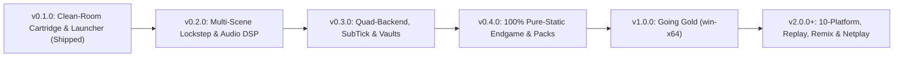

# Roadmap

Current baseline: **v0.1.0 (`Clean-Room Cartridge, Launcher & DualSetup8 Installer`)** | Next target: **v0.2.0 (`Multi-Scene Lockstep & Audio DSP`)** | See [CHANGELOG.md](CHANGELOG.md) for release notes.

## 1. North Star Goal

Deliver **Going Gold (`v1.0.0` on `win-x64`)** as the flagship clean-room proving ground for `reCart` and `reEngine`: a bit-authentic, `100%` pure-static `60.0988 Hz` recompilation of `IronFrame OuterFortress (Cart) 01` verified start-to-escape across all four production render backends (`OpenGL`, `Vulkan`, `DirectX 12`, `ParallelCpu`), preserving authentic simulation by default while offering modern opt-in enhancements.

## 2. Shipped Milestone: `v0.1.0` — Clean-Room Cartridge, Launcher & `DualSetup8` Baseline

- **Cornerstone Theme:** Establish the slim clean-room `.recomp` recipe module, multi-format BYO ROM validator (`.nes`/`.prg`/`.zip`/`.7z`), `< 2 MB` launcher, zero-daemon DualSetup8 installer, and isolated unit/sandbox/lockstep verification suite on `reCart v0.1.3` + `reEngine v0.6.2` + `Foundation v0.5.5`.
- **Milestone Deliverables:**
  - [x] Refresh the `v0.1.0` technical blueprint against live `reCart v0.1.3`, `reEngine v0.6.2`, `Foundation v0.5.5`, and read-only `IronFrame-OuterFortress-Cart-01-Decomp v0.4.0` schemas.
  - [x] Build `IronFrameCart01.RecipeGen` and `IronFrameCart01.Module` emitting clean-room `aot-recipe.json` (`499` function seeds, `37` entries, `jumpTables: ["0xC6B7"]` lifted cleanly across fixed/switchable banks with `0` hardcoded retail ROM addresses, `17` `UNROM` trampolines, `$0200`/`$0300`/`$0380` memory watches) and dual `.nes`/`.prg` BYO validation (`IronFrame-OuterFortress-Cart-01.recomp`, strict 2-member `9,167 B` JSON archive).
  - [x] Build the `< 2 MB` (`1,032,184 B`) `IronFrame-OuterFortress-Cart-01.exe` Launcher (`AllowAutoStart = false`, deterministic `reCart` resolution, `LauncherMediaDiscovery` pre-flight `.nes`/`.prg`/`.zip`/`.7z` discovery via `MediaContainerExtractor` + `tools\7z.*` & Clean-Room Media Gate routing, instant window launch + AOT overlay, `0 px` jitter `F3` HUD, persisted `F1` settings, path-containment guards, split-domain settings seeding) and signed `DualSetup8` Installer (`IronFrame-OuterFortress-Cart-01-{Setup,Offline-Setup}-v0.1.0-win-x64.exe`, suite-first coded install root `StreamItAll\reEngine\games\IronFrame-OuterFortress-Cart-01\`) preserving `data\rom\` and settings across upgrades.
  - [x] Pass `50` zero-asset unit tests (`/warnaserror`, `0` warnings, incl. `PrelaunchRegressionTests`) plus 4-drive installed sandbox verification (`[S2-00]`..`[S2-09]`: Offline `Full`, Online `--offline-bundle`, adjacent verified Portable discovery, clean default coded install, `[S2-06]` Missing-ROM Media Gate `2.68s` + Demo Cart + corrupt `.7z` warning, `[S2-07]` Cold `.7z` AOT boot `4.21s` + `.zip`/`.prg`/`.nes` format matrix + `Enter` gameplay progression past title + `0 px` jitter `F3` HUD `w=623px` + QuickSave/Load + WAV `peakPcm=16286`, `[S2-08]` persisted `F1` settings across quit/relaunch, `[S2-09]` standalone raw-ROM `.recomp` guard `2.18s`), `--lockstep-oracle --lockstep-steps 20000` differential check (`mismatchedSteps=0`), and live Wizard/Game GUI visual inspection.

## 3. Upcoming Milestones

- **`v0.2.0` — Multi-Scene Infiltration Lockstep & `$0380` Audio DSP** *(Aligned to `reCart v0.2.0–v0.3.0`)*
  - **Cornerstone Theme:** Achieve cycle-synchronized multi-scene parity and studio-clean Blip-buffer audio classification.
  - **Key Deliverables:** Certify `5`-scene (`650`-frame) execution lockstep with zero mismatches under `reCart`'s cooperative scheduler and Tier 3 bring-up; classify `BANK_06` `$0380` `BGM`/`SFX` cues cleanly for host sliders and Sound Test jukebox; validate `RCARTQS2` quick-save/restore parity across bank transitions.

- **`v0.3.0` — Quad-Backend Presentation, Opt-In `120–240 Hz` Smoothing & Vaults** *(Aligned to `reCart v0.4.0–v0.5.0` + `reEngine v0.7.0–v0.8.0`)*
  - **Cornerstone Theme:** Deliver full visual/UX polish without altering `60.0988 Hz` simulation defaults.
  - **Key Deliverables:** Certify `ParallelCpu` `1x` bit-exactness plus `Vulkan`/`DirectX 12`/`OpenGL`; add opt-in `>8`-sprite flicker removal (`$2002.5` untouched), split-safe `120–240 Hz` `SubTick` scrolling, `8px` overscan + `hudAnchorMode`, and Hor+ `16:9`/`21:9` side-wings; wire the 10-rail controller overlay, Dynamic Prompts, Save Vault + 1-Step `F5`/`F9` Undo, and Password Vault.

- **`v0.4.0` — `100%` Pure-Static Endgame, Clean-Room Manual & `.re*` Recipes** *(Aligned to `reCart v0.6.0–v0.7.0` + `reEngine v0.9.0–v0.11.0`)*
  - **Cornerstone Theme:** Eliminate all non-static execution fallbacks start-to-escape and ship clean-room player/modder tooling.
  - **Key Deliverables:** Reach `100%` pure-static execution (`0` JIT/interpreter dispatches) across Building 1–3 keycards, boss encounters, and countdown escape; ship bundled clean-room Game Manual, Tactical Tracker (`tracker.layout.json`), `assets.catalog.json`, deterministic `hd_recipe.json` & `.reSub` subtitle recipe support, `.re*` hot-reload, Research RAM/tile watches, opt-in Release Runtime API, Clean-Capture mode, and Add-to-Steam support.

- **`v1.0.0` — Going Gold (`win-x64` General Availability)**
  - **Cornerstone Theme:** Complete full end-to-end automated and human certification as Proving Ground #1 for `reCart v1.0.0`.
  - **Key Deliverables:** Pass the `10`-fixture multi-zone automated suite across all `4` Windows backends (`0` errors), complete full start-to-escape maintainer playthrough sign-off (`isHumanPlaytestSignedOff = true`), and ship the signed GA Dual-Installer + Portable release bundle.

- **`v2.0.0–v5.0.0` — Post-Gold Major Horizons**
  - **`v2.0.0` (Cross-Platform & Unified Hub):** 10-platform portability (Linux, macOS `MoltenVK`, Steam Deck, Mobile `W^X`, WebAssembly OPFS, consoles), SDL3 Game Hub integration, Quick-Resume, first-party local achievements (`achievements.recomp.json`, zero external achievement network calls), and opt-in Discord Rich Presence.
  - **`v3.0.0` (Replayability & Creator Suite):** Rewind ring buffer, customizable replay clips, `.reTas` movie tooling, cheats, native Speedrun Timer (`IGT`/`RTA`), Photo Mode, and optional Host Frame Generation.
  - **`v4.0.0` (Remix Engine):** Soft ROM patching (`IPS`/`BPS`/`UPS`/`xdelta`), Native Randomizer (`randomizerSeed`, spoiler log, tracker link), and advanced `.reMod` scripting hooks.
  - **`v5.0.0` (Connected Summit):** Deterministic LAN/online Rollback Netplay and Replay Theatre.

## 4. Completed Milestones

| Version | Date | Headline Achievement | Reference |
| :--- | :--- | :--- | :--- |
| `v0.1.0` | `2026-11-23` | Shipped clean-room `499`-seed + `$C6B7` jump-table `aot-recipe.json`, 2-member `.recomp` cartridge (`9,167 B`), `< 2 MB` `IronFrame-OuterFortress-Cart-01.exe` Launcher (`LauncherMediaDiscovery` `.nes`/`.prg`/`.zip`/`.7z` + Clean-Room Media Gate), instant-window async AOT + `0 px` jitter HUD + persisted `F1` settings (`reCart v0.1.3` + `reEngine v0.6.2`), coded `DualSetup8` Installer (`audit_installer.ps1` `0` findings), `50` zero-asset unit tests (`/warnaserror`), Stage 2 4-drive Sandbox E2E (`[S2-00]`..`[S2-09]`, WAV `peakPcm=16286`, persisted `F1` relaunch, standalone raw-ROM guard), and `20,002`-step lockstep (`mismatchedSteps=0`). | [CHANGELOG.md](CHANGELOG.md) |
| `v0.1.0-scope` | `2026-11-23` | Authored project charter (`Dev/docs/CHARTER.md`), adopted coded package naming (`ironframe-outerfortress-cart-01`), aligned milestones onto `reCart` + `reEngine` + `Foundation`, and enforced clean-room public standards. | [CHANGELOG.md](CHANGELOG.md) |

## 5. Icebox

- **Home-Computer Edition Comparative Notes:** Optional read-only architectural comparison notes belong in the upstream research repository, never inside this recompilation cartridge module.
- **Zero-Emulation Standalone Native Port:** Any future engine-independent native port or rewrite lives strictly in a separate repository outside this recompilation module.
